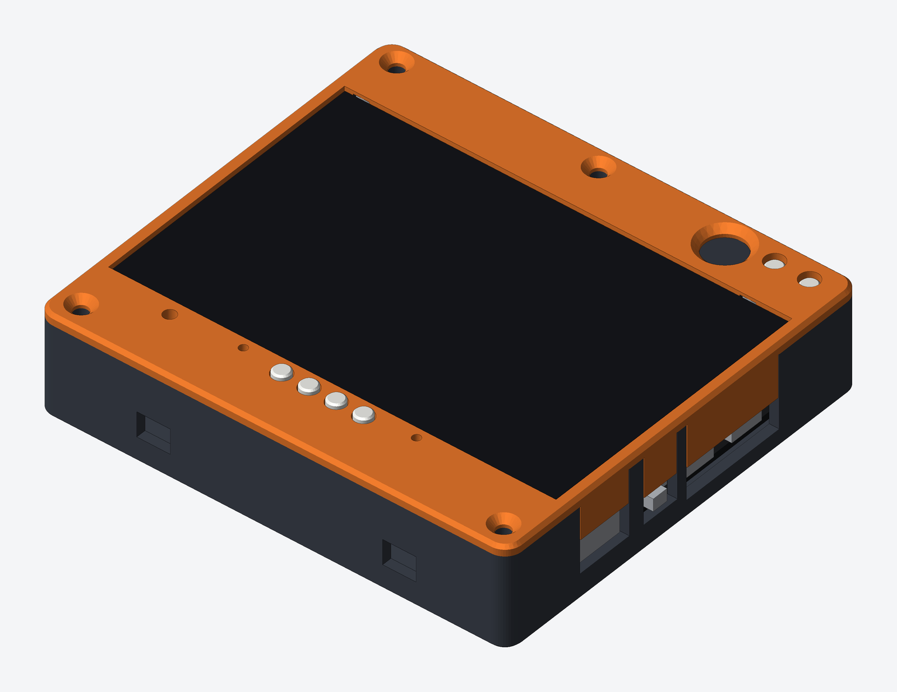

# ESP32-S31-Korvo-1 case

FDM-printable case for the Espressif [ESP32-S31-Korvo-1 V1.1](https://docs.espressif.com/projects/esp-dev-kits/en/latest/esp32s31/esp32-s31-korvo-1/user_guide.html)
with its 4.3" LCD subboard mounted. Parametric, generated from `case.py` with
[build123d](https://github.com/gumyr/build123d).



Outer size 112.3 × 102.0 × 24.6 mm. No heat inserts; all screws are countersunk
and sit flush, front and back.

> **Not print-tested.** Several heights are not in Espressif's drawings and are
> estimates. Measure them on your board first, see [Measure before printing](#measure-before-printing).

## Features

- LCD window, glass recessed 0.6 mm behind the bezel face
- Openings for USB-A, both USB-C ports, power switch, microSD, camera, two
  microphones, RGB LED and two speaker cables
- Printed plungers for all six buttons: SET, MODE, VOL−, VOL+ stand 1 mm proud;
  RESET and BOOT sit 1 mm recessed (press with a pen tip)
- Board drops straight in: the port slots are open at the top and closed by
  tongues on the bezel

## Print

Files are in `stl/`, already in print orientation. No supports needed.

| File | Qty | Orientation |
|---|---|---|
| `print_shell.stl` | 1 | back down |
| `print_bezel.stl` | 1 | face down |
| `print_button_long_x4.stl` | 4 | foot down |
| `print_button_short_x2.stl` | 2 | foot down |

Designed for a 0.4 mm nozzle (2.4 mm walls, 2.0 mm floor). The only bridges are
the microSD window (18 mm), the speaker cable holes (8 mm) and the nut trap
ceilings (~6 mm).

A test print with 0.5 mm nozzle and 100% infill succeeded without supports.

Print one button first as a fit test.

Optional: the short buttons keep RESET and BOOT recessed so they are not
pressed by accident. If you prefer to press them with a finger, use long
buttons in those two positions as well (six long, no short); both types fit
the same holes.

## Hardware

| Qty | Part | Use |
|---|---|---|
| 4 | M3×10 countersunk | back → shell → main board → board standoffs |
| 4 | M3×25 countersunk | front → bezel → shell column → nut |
| 4 | M3 hex nut | in the traps in the back of the shell |

Note: M3x20 will technically fit instead of M3x25, but printing the hex-shaped well might prove tricky, because the nuts might not fall through deep enough.

## Assembly

1. Remove the four screws on the back of the main board. Leave the standoffs
   and the LCD subboard in place.
2. Lower the board stack into the shell, port side first.
3. Fasten it from the back with the four M3×10 screws into the standoffs.
4. Drop the six plungers onto their switches (long: bottom row, short: next to
   the camera).
5. Fit the bezel and fasten it with the four M3×20 screws; push a nut into each
   trap in the back.

You might need to file or cut a bit of a chamfer near the USB A connector to get it closing perfectly (0.5 to 1 mm).

## Known compromises

- The top bezel screws are asymmetric (left corner and mid-top) because the
  camera tab occupies the top-right corner. That corner is held by the bezel
  tongues only.
- The mid-top screw and nut sit about 5 mm from the antenna tip, which may
  affect RF slightly.
- The microSD card sits about 6 mm behind the top wall; use a fingernail or
  tweezers.

## Regenerate

```sh
.venv-cad/bin/python case.py     # STEP into step/, STL into stl/
.venv-cad/bin/python check.py    # validity + interference checks, line drawings
.venv-cad/bin/python render.py   # shaded picture above
```

`.venv-cad` is a Python 3.12 environment with `build123d`, `ezdxf` and `pillow`.
`check.py` also needs ImageMagick (`magick`).

## Files

| Path | Content |
|---|---|
| `case.py` | the model and all parameters |
| `check.py`, `render.py` | checks and previews |
| `step/korvo_case_*.step` | shell, bezel, buttons and full assembly |
| `step/korvo_board_stack_reference.step` | simplified board model used for fit checks |
| `stl/print_*.stl` | parts to print |
| `preview/` | line drawings and the shaded render |

## Sources

Dimensions were taken from Espressif's documentation (not included here):

- [ESP32-S31-Korvo-1 user guide](https://docs.espressif.com/projects/esp-dev-kits/en/latest/esp32s31/esp32-s31-korvo-1/user_guide.html)
- [Korvo-1 dimensions (PDF)](https://dl.espressif.com/schematics/esp32-s31-korvo-1-dimensions.pdf)
  and [DXF](https://dl.espressif.com/schematics/esp32-s31-korvo-1-dimensions.dxf):
  board outline, mounting holes, connector positions
- [Korvo-1 PCB layout (PDF)](https://dl.espressif.com/schematics/esp32-s31-korvo-1-pcb-layout.pdf)
- [ESP32-S3-LCD-EV-Board user guide](https://docs.espressif.com/projects/esp-dev-kits/en/latest/esp32s3/esp32-s3-lcd-ev-board/user_guide.html)
  (LCD subboard SUB3)
- [SUB3 V1.3 PCB layout (PDF)](https://dl.espressif.com/dl/schematics/PCB_ESP32-S3-LCD-EV-Board-SUB3_V1.3_20230317.pdf):
  subboard outline, holes, LCD position
- [WKS43246 4.3" LCD specification (PDF)](https://dl.espressif.com/dl/schematics/WKS43246_SPEC_V0.0.pdf):
  LCD module size

## License

[MIT](LICENSE). This covers the scripts and the generated case models.
